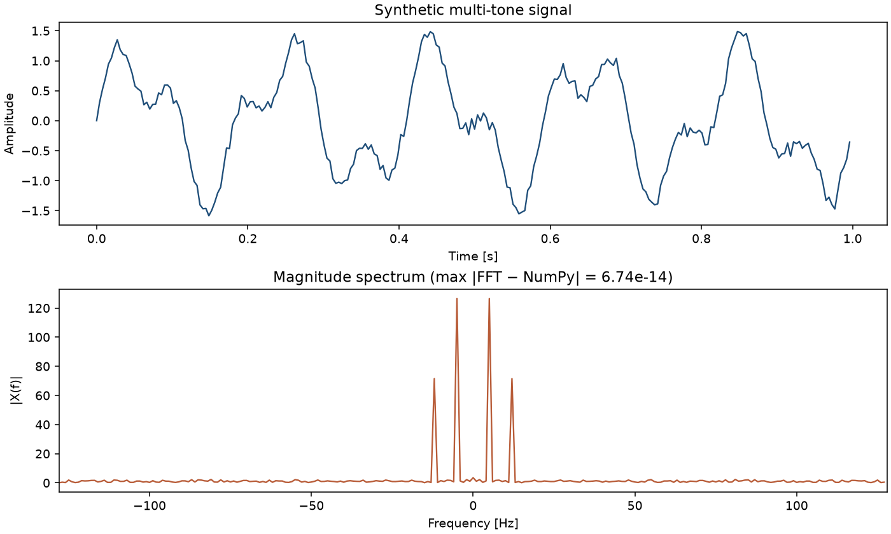
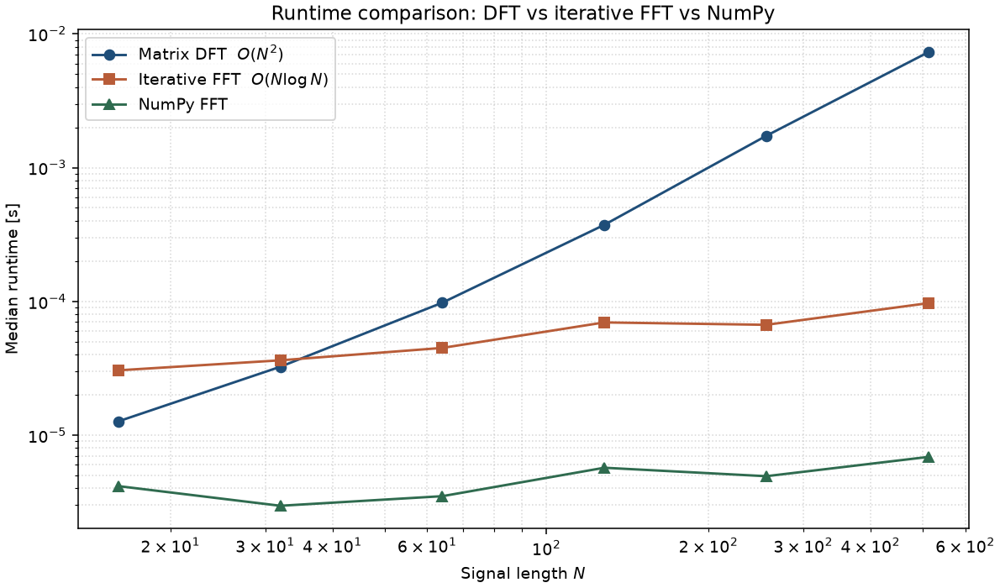

# Fourier 1D

From-scratch **1-D Discrete Fourier Transform (DFT)** and **iterative radix-2 FFT** in Python — a small signal-analysis package with clean architecture, NumPy-validated spectra, and runtime benchmarks that make the $O(N^2)$ vs $O(N\log N)$ trade-off visible.

Built as a portfolio use case from an early academic script: implement the transform from first principles, expose a focused analysis API, and verify results on a controlled multi-tone signal.

---

## Use case

Given a discrete time series $x[n]$, recover its frequency content $X[k]$ without relying on a black-box FFT for the core transform. The project targets workflows where transparency matters—teaching checks, method audits, or lightweight spectral exploration—while remaining numerically comparable to `numpy.fft`.

Typical flow:

1. Build or load a 1-D signal.
2. Compute the spectrum with the matrix DFT or the Cooley–Tukey FFT.
3. Inspect magnitude / phase / power spectra on a physical frequency axis.
4. Cross-check against NumPy and confirm time–frequency energy consistency (Parseval).

---

## Mathematical formulation

The length-$N$ forward DFT is

$$
X_k = \sum_{n=0}^{N-1} x_n \, e^{-2\pi i kn / N},
\qquad k = 0,\ldots,N-1.
$$

In matrix form, $X = W x$ with entries

$$
W_{kn} = e^{-2\pi i kn / N}.
$$

The inverse transform restores the time series:

$$
x_n = \frac{1}{N} \sum_{k=0}^{N-1} X_k \, e^{2\pi i kn / N}.
$$

For $N = 2^m$, the radix-2 FFT evaluates the same $X_k$ in $O(N \log N)$ operations. Frequency bins map to Hertz through the sampling rate $f_s$:

$$
f_k = \frac{k}{N} f_s,
\qquad k = -\tfrac{N}{2},\ldots,\tfrac{N}{2}-1
$$

(when the spectrum is centered). Parseval’s relation used in the tests is

$$
\sum_{n=0}^{N-1} |x_n|^2 = \frac{1}{N} \sum_{k=0}^{N-1} |X_k|^2.
$$

Further detail lives in [`docs/use_case.md`](docs/use_case.md).

---

## Architecture

```
src/fourier_1d/
  dft.py         # DFT / IDFT (matrix) and radix-2 FFT / IFFT
  spectrum.py    # frequency axis, magnitude, phase, power
  signals.py     # synthetic multi-tone fixtures
  io.py          # two-column time-series load/save
examples/
  run_demo.py         # end-to-end plot + NumPy error report
  run_benchmark.py    # DFT vs FFT vs NumPy runtime comparison
tests/                # agreement with numpy.fft and Parseval checks
docs/                 # use-case write-up with equations
.github/workflows/    # CI (pytest on Python 3.10–3.12)
```

Design choices:

- **Separation of concerns** — transform kernels, spectral helpers, and signal fixtures are independent modules.
- **Explicit algorithms** — matrix DFT preserves the original pedagogical intent; an iterative radix-2 FFT adds the practical $O(N\log N)$ path without recursion.
- **Reference validation** — every transform path is checked against `numpy.fft` in automated tests (GitHub Actions CI on Python 3.10–3.12).
- **Reproducible demo signal** — replaces the unversioned `funcion.dat` from the legacy script.

---

## Quick start

```bash
python -m venv .venv
source .venv/bin/activate
pip install -e ".[dev]"
pytest
python examples/run_demo.py
python examples/run_benchmark.py
```


Minimal API usage:

```python
from fourier_1d import fft, magnitude_spectrum, sample_signal

t, y, fs = sample_signal()
freqs, mag = magnitude_spectrum(y, sample_rate=fs)
X = fft(y)
```

---

## Validation snapshot

On the bundled multi-tone demo ($5\,\mathrm{Hz}$ + $12\,\mathrm{Hz}$), the custom FFT matches `numpy.fft.fft` to machine precision (max absolute error $\sim 10^{-14}$). Magnitude peaks appear at the injected tones; round-trip DFT ↔ IDFT recovers the original samples.



Runtime on increasing power-of-two lengths shows the expected complexity gap between the matrix DFT and the iterative FFT (NumPy remains the highly optimized baseline):



---

## Requirements

- Python ≥ 3.10
- NumPy ≥ 1.24
- Optional: Matplotlib (demo), pytest (tests)

---

## License

MIT — see [`LICENSE`](LICENSE).
